# 🏠 Configuração de Rede Doméstica no Cisco Packet Tracer


## 📌 1. Sobre o projeto

Este projeto apresenta a montagem e configuração de uma rede doméstica utilizando o **Cisco Packet Tracer**, ferramenta de simulação de redes desenvolvida pela Cisco.

O laboratório consiste na implementação de uma infraestrutura de rede residencial, realizando conexões cabeadas e sem fio entre diferentes dispositivos.

Durante a atividade, foram configurados um Cable Modem, um Home Wireless Router, computadores, televisão e laptop, além de parâmetros de endereçamento IP, DHCP e segurança da rede wireless.

Também foram realizados testes de conectividade para verificar a comunicação dos dispositivos com a rede e o acesso a um servidor externo simulado.

## 🎯 2. Objetivos

- Montar uma infraestrutura de rede doméstica.
- Realizar conexões utilizando cabos coaxiais e Ethernet.
- Conectar o Cable Modem ao roteador wireless.
- Configurar computadores para receber endereços IP automaticamente por DHCP.
- Acessar a interface administrativa do roteador.
- Configurar o limite de usuários do servidor DHCP.
- Alterar as credenciais administrativas padrão.
- Configurar uma rede Wi-Fi com segurança WPA2.
- Conectar dispositivos à rede wireless.
- Realizar testes de conectividade entre os dispositivos.
- Verificar o acesso ao servidor `skillsforall.srv`.

## 🛠️ 3. Equipamentos e tecnologias utilizados

### Equipamentos

| Equipamento | Função |
|---|---|
| Cable Splitter | Divisão do sinal coaxial |
| Cable Modem | Conexão com a rede externa |
| Home Wireless Router | Gerenciamento da rede doméstica |
| TV | Recepção do sinal de televisão |
| Office PC | Computador conectado por cabo |
| Bedroom PC | Computador conectado por cabo |
| Laptop | Dispositivo conectado via Wi-Fi |

### Tecnologias e conceitos

- Cisco Packet Tracer
- LAN (Local Area Network)
- WLAN (Wireless Local Area Network)
- IPv4
- DHCP (Dynamic Host Configuration Protocol)
- Ethernet
- Cabo coaxial
- Wi-Fi
- WPA2-PSK
- Roteamento doméstico
- Conectividade de rede

---

# 💻 4. Desenvolvimento do projeto

## ETAPA 1 — Conexão do cabo de televisão

Nesta primeira etapa, foi realizada a conexão entre o divisor de cabo (Cable Splitter), o Cable Modem e a televisão.

### Procedimentos

1. Acesse **Network Components** e clique em **Connections**, identificado pelo ícone de raio.
2. Selecione o cabo coaxial, identificado pelo ícone azul em formato de zigue-zague.
3. Clique no Cable Splitter e selecione a porta `Coaxial1`.
4. Clique no Cable Modem e selecione a porta `Port 0`.
5. Repita o procedimento utilizando a porta `Coaxial2` do Cable Splitter e a porta `Port 0` da TV.
6. Clique na televisão e altere o campo **Status** para **ON**.

Após realizar corretamente as conexões, a televisão deverá apresentar uma imagem representando um programa de TV.

### 📷 Evidências da configuração

**Figura 01 — Conexão do cabo coaxial**

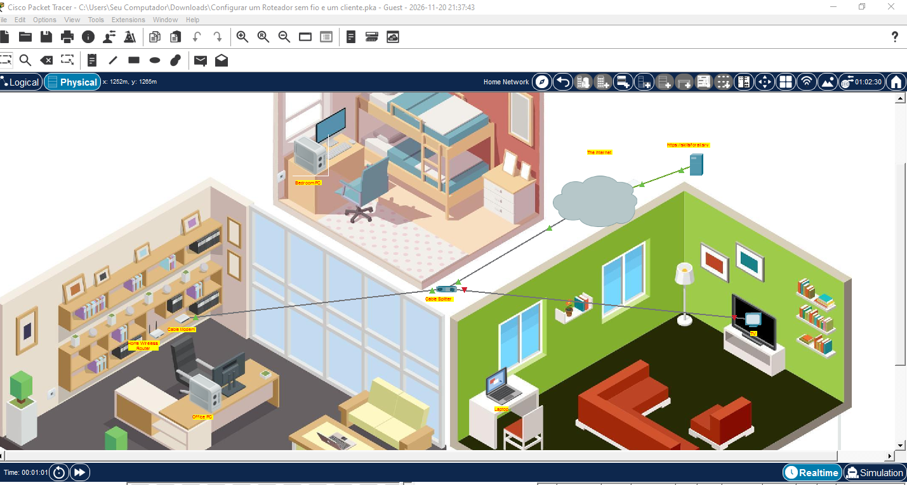

**Figura 02 — Televisão funcionando**

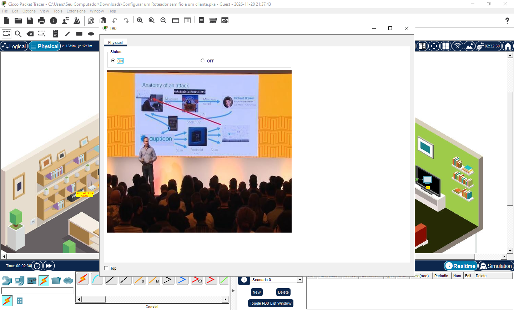

---

## ETAPA 2 — Conexão do modem e do roteador wireless

Nesta etapa, foi realizada a conexão entre o Cable Modem, o Home Wireless Router e os computadores da residência.

### Procedimentos

1. Acesse **Connections** e selecione o cabo **Copper Straight-Through**, identificado por uma linha preta sólida.
2. Conecte a porta `Port 1` do Cable Modem à porta `Internet` do Home Wireless Router.
3. Selecione o Office PC e conecte a porta `FastEthernet0` à porta `GigabitEthernet 1` do roteador.
4. Repita o procedimento para conectar o Bedroom PC à porta `GigabitEthernet 2` do roteador, utilizando a porta `FastEthernet0` do computador.

### 📷 Evidências da configuração

**Figura 03 — Conexão entre Cable Modem e Home Wireless Router**

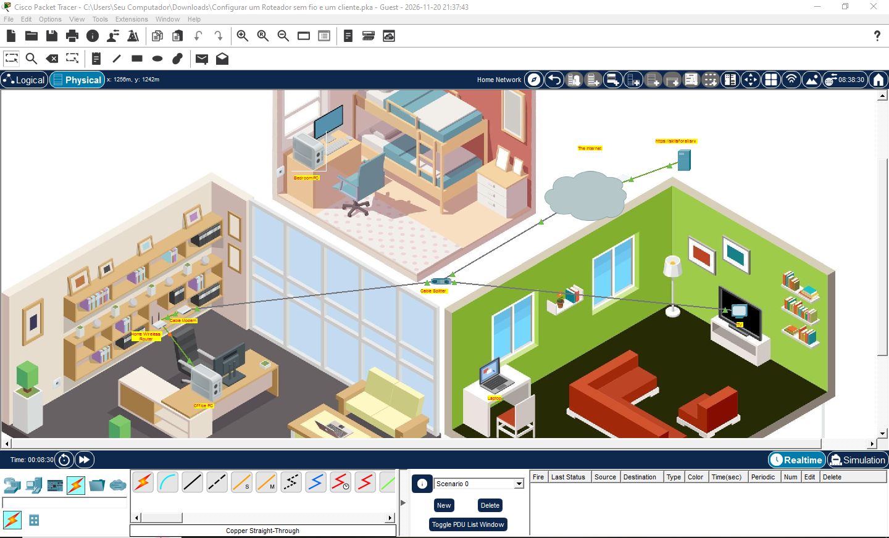

**Figura 04 — Conexão do computador do quarto**

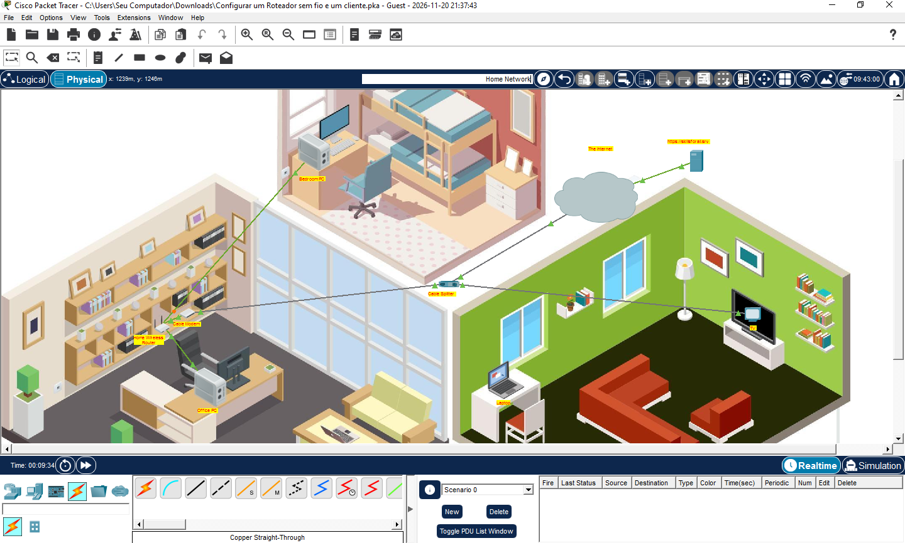

---

## ETAPA 3 — Configuração do roteador e do DHCP

Nesta etapa, foi realizada a configuração inicial do roteador wireless, incluindo acesso à interface administrativa, configuração do DHCP, limitação de usuários e alteração da senha administrativa.

### 3.1. Acessando a interface do roteador

1. Clique no **Office PC**.
2. Acesse a guia **Desktop**.
3. Abra **IP Configuration**.
4. Selecione a opção **DHCP**.
5. Aguarde a obtenção automática das configurações de rede.

O computador deverá receber um endereço IPv4 iniciado por `192`.

Caso a configuração demore, utilize a opção **Fast Forward Time**, localizada abaixo da topologia de rede.

6. Anote o endereço do **Default Gateway**, que corresponde ao endereço IP do Home Wireless Router.
7. Feche a janela IP Configuration.
8. Abra o aplicativo **Web Browser**.
9. Digite o endereço IP do gateway padrão no campo URL e clique em **Go**.
10. Na tela de autenticação, utilize as credenciais padrão do laboratório:

- Usuário: `admin`
- Senha: `admin`

Após a autenticação, será exibida a interface gráfica de configuração do roteador.

### 📷 Evidência

**Figura 05 — Configuração DHCP e acesso à rede**

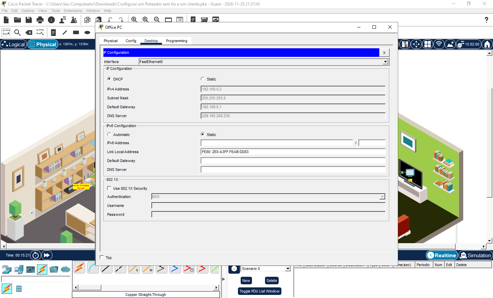

**Figura 06 — Acesso à interface administrativa do roteador**

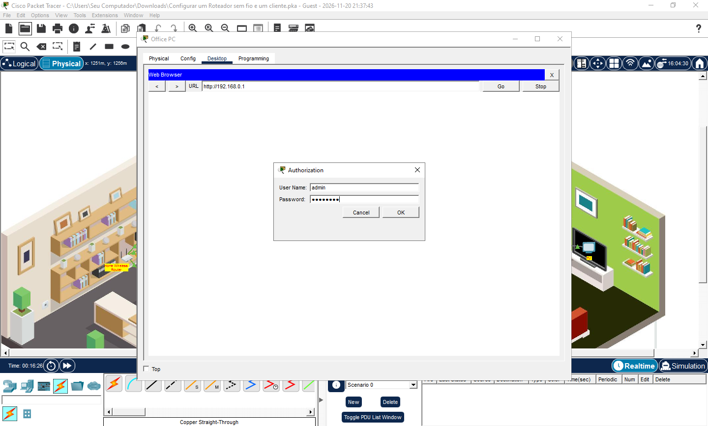

### 3.2. Configurando o limite máximo de usuários DHCP

O objetivo desta configuração é limitar a quantidade de dispositivos que poderão receber endereços IP automaticamente.

A proposta do laboratório considera que não mais de 10 dispositivos estarão conectados simultaneamente à rede doméstica.

### Procedimentos

1. Na interface do roteador, permaneça na guia **Setup**.
2. Localize a seção **Network Setup**.
3. Encontre o campo **Maximum Number of Users**.
4. Altere o valor para `10`.
5. Role a página até o final.
6. Clique em **Save Settings**.

Essa configuração limita a quantidade de endereços disponibilizados pelo servidor DHCP aos dispositivos conectados à rede.

### 📷 Evidência

**Figura 07 — Configuração do limite máximo de usuários**

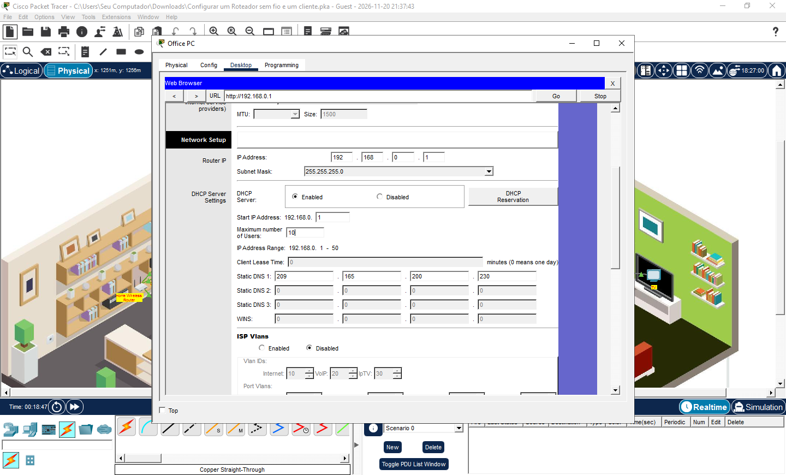

### 3.3. Alterando a senha administrativa

Por segurança, é importante substituir as credenciais padrão do roteador.

### Procedimentos

1. Acesse a guia **Administration**.
2. Localize os campos de senha administrativa.
3. Defina uma nova senha.
4. Confirme a nova senha.
5. Clique em **Save Settings**.

**Observação de segurança:** as credenciais administrativas padrão devem ser alteradas, pois são amplamente conhecidas. Não publique senhas reais ou credenciais pessoais no GitHub.

### 📷 Evidência

**Figura 08 — Alteração da senha administrativa**

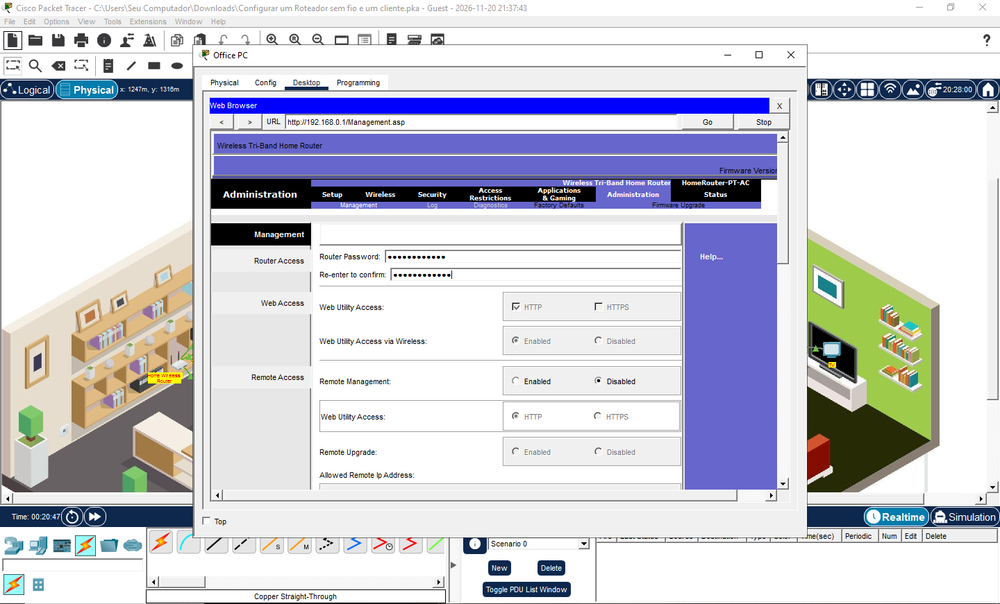

---

## ETAPA 4 — Configuração da rede Wi-Fi e segurança WPA2

Nesta etapa, foi realizada a configuração da rede wireless e a conexão do laptop à rede doméstica.

### 4.1. Configurando a rede sem fio

No Home Wireless Router, acesse as configurações wireless e defina:

- Nome da rede (SSID): nome de sua preferência.
- Modo de segurança: WPA2.
- Tipo de criptografia: conforme disponibilizado pelo roteador.
- Senha da rede: defina uma senha segura para o laboratório.

Após realizar as configurações, clique em **Save Settings**.

### 📷 Evidência

**Figura 09 — Configuração da rede wireless**

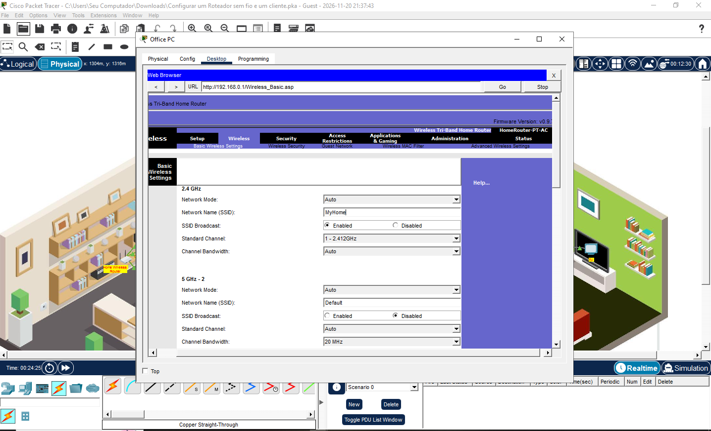

### 4.2. Configurando a segurança WPA2

1. Acesse as configurações de segurança wireless.
2. Selecione o protocolo WPA2-PSK, caso disponível.
3. Defina a chave pré-compartilhada (**Pre-Shared Key**).
4. Salve as alterações.

O WPA2 adiciona uma camada de proteção à rede sem fio, exigindo uma senha para autenticação dos dispositivos.

### 📷 Evidência

**Figura 10 — Configuração de segurança WPA2**

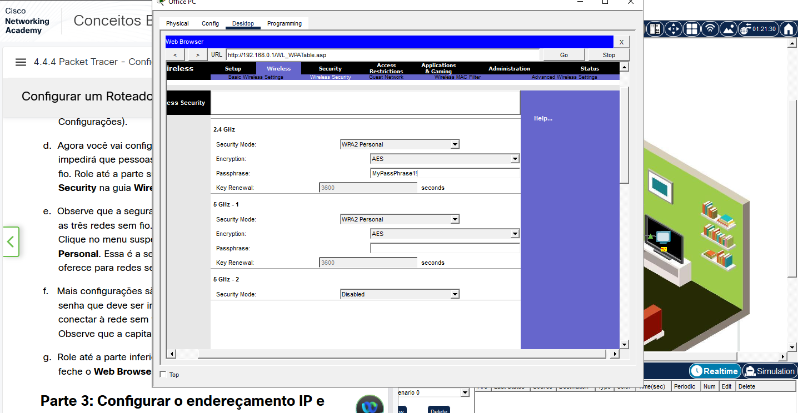

### 4.3. Conectando o laptop à rede Wi-Fi

1. Clique no **Laptop** localizado na sala de estar.
2. Acesse a guia **Desktop**.
3. Abra o aplicativo **PC Wireless**.
4. Entre na guia **Connect**.
5. Aguarde a identificação das redes wireless disponíveis.
6. Selecione o SSID configurado anteriormente.
7. Clique em **Connect**.
8. Digite a senha configurada no campo **Pre-shared Key**.
9. Clique novamente em **Connect**.
10. Acesse a guia **Link Information**.

A conexão será realizada corretamente quando aparecer a mensagem:

`You have successfully connected to the access point`

Clique em **More Information** para visualizar os detalhes da conexão.

Caso o endereço IP não comece com `192`, utilize **Fast Forward Time** para acelerar a simulação.

### 📷 Evidência

**Figura 11 — Laptop conectado com sucesso ao ponto de acesso**

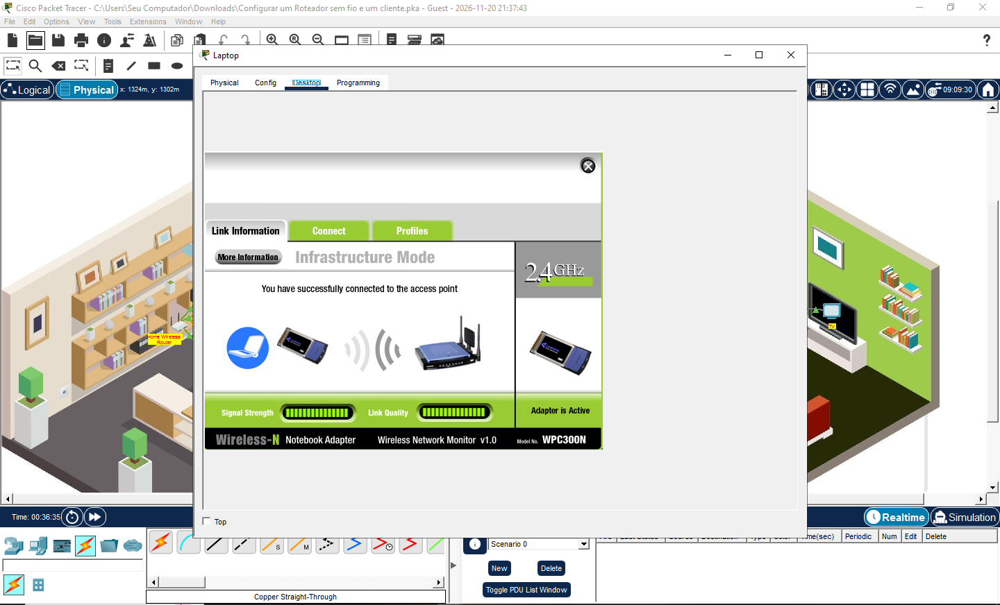

### 4.4. Testando o acesso à Internet simulada

1. Feche o aplicativo **PC Wireless**.
2. Abra o **Web Browser**.
3. Acesse o endereço:

`skillsforall.srv`

4. Aguarde o carregamento da página.
5. Utilize **Fast Forward Time** caso necessário.

O carregamento da página demonstra que o laptop possui conectividade com o servidor externo simulado no Packet Tracer.

---

## ETAPA 5 — Configuração do Bedroom PC e testes finais

Nesta última etapa, foi realizada a configuração do segundo computador da residência e a verificação da conectividade.

### 5.1. Configurando o Bedroom PC

1. Clique no **Bedroom PC**.
2. Acesse a guia **Desktop**.
3. Abra **IP Configuration**.
4. Selecione **DHCP**.
5. Aguarde a atribuição automática do endereço IP.

Verifique se o endereço IPv4 recebido começa com `192`.

### 📷 Evidência

**Figura 12 — Configuração DHCP do computador do quarto**

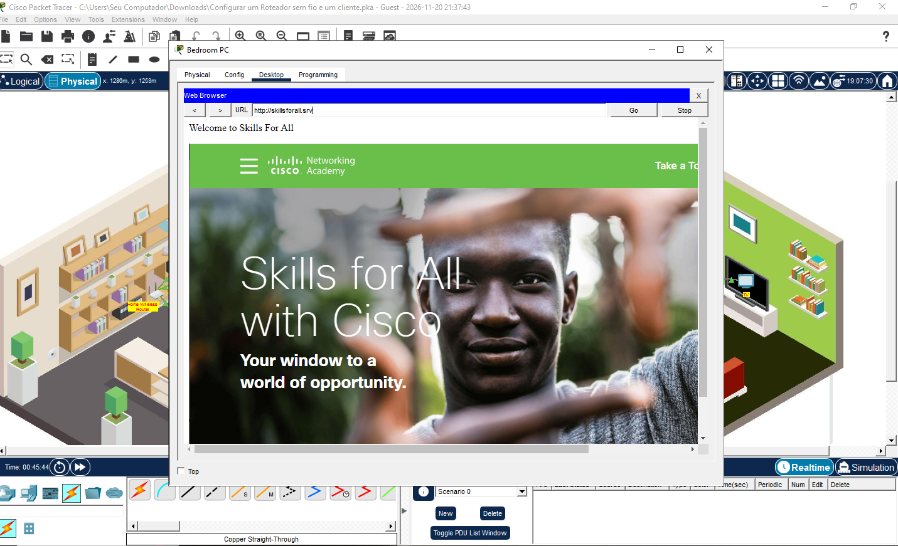

### 5.2. Testando a conectividade

1. Feche a janela **IP Configuration**.
2. Abra o aplicativo **Web Browser**.
3. Digite o endereço:

`skillsforall.srv`

4. Aguarde o carregamento da página.
5. Utilize **Fast Forward Time** caso necessário.

O acesso ao servidor confirma a conectividade do Bedroom PC com a rede simulada.

### 📷 Evidência

**Figura 13 — Teste de conectividade do Office PC**

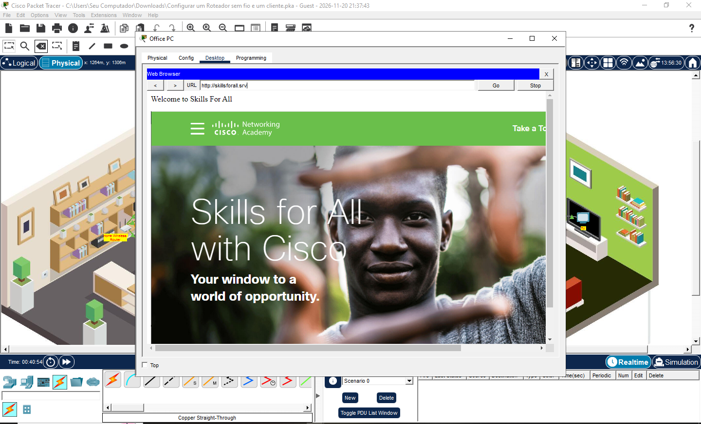

---

# 📊 5. Resultados obtidos

Após a realização das etapas de configuração, foram contemplados os seguintes resultados esperados:

| Configuração | Resultado esperado |
|---|---|
| Conexão coaxial | TV e Cable Modem conectados |
| Conexão Ethernet | Modem, roteador e computadores conectados |
| DHCP | Endereços IP atribuídos automaticamente |
| Limite de usuários | Máximo de 10 usuários configurado |
| Administração | Credenciais administrativas alteradas |
| Rede wireless | SSID configurado |
| Segurança Wi-Fi | WPA2 configurado |
| Laptop | Conectado ao ponto de acesso |
| Office PC | Teste de conectividade |
| Bedroom PC | Teste de conectividade |

# 🎓 6. Conhecimentos adquiridos

Durante a execução deste laboratório, foram praticados conceitos importantes de infraestrutura e administração de redes:

- Montagem de uma rede doméstica.
- Identificação e utilização de cabos de rede.
- Conexões coaxiais e Ethernet.
- Configuração de equipamentos de rede.
- Endereçamento IPv4.
- Funcionamento do DHCP.
- Configuração de roteadores wireless.
- Administração de credenciais.
- Segurança de redes Wi-Fi utilizando WPA2.
- Conectividade entre dispositivos cabeados e sem fio.
- Testes de acesso a servidores.

# ✅ 7. Conclusão

A realização deste projeto permitiu colocar em prática conceitos fundamentais de redes de computadores utilizando o Cisco Packet Tracer como ambiente de simulação.

Foram desenvolvidas atividades envolvendo cabeamento coaxial, conexões Ethernet, configuração de roteadores, endereçamento IPv4, DHCP, segurança wireless e testes de conectividade.

O laboratório demonstrou como diferentes dispositivos podem ser integrados em uma rede doméstica, permitindo comunicação entre equipamentos cabeados e sem fio.

Além dos conhecimentos técnicos, a atividade reforçou a importância da organização, documentação e aplicação de boas práticas de segurança na configuração de redes.

**Projeto concluído!**

---

## 📁 8. Estrutura do repositório

```text
configuracao-rede-domestica-cisco-packet-tracer/
│
├── README.md
│
├── images/
│   ├── 1-Cabo-tv.PNG
│   ├── 1.1-tv-funcionando.PNG
│   ├── 2.1-pc-do-quarto.PNG
│   ├── 2.Cabo-modem-e-Home-wireless.PNG
│   ├── 3.1-entrando.PNG
│   ├── 3.2-Maximum-number.PNG
│   ├── 3.3-confi-nova-senha.PNG
│   ├── 3.Confg-dhcp.PNG
│   ├── 4-conf-wifi.PNG
│   ├── 4.1-config-wpa2.PNG
│   ├── 4.2-conectado-com-sucesso.PNG
│   ├── 5-officepc-ok.PNG
│   └── 5.1-pc-quarto.PNG
│
└── projeto/
    └── rede-domestica.pkt
```

**Observação:** o arquivo `.pkt` é opcional e poderá ser adicionado para permitir que outras pessoas abram a topologia no Cisco Packet Tracer.

---

## 🚀 9. Ferramentas utilizadas

- [Cisco Packet Tracer](https://www.netacad.com/cisco-packet-tracer)
- [GitHub](https://github.com/)

**Categoria:** Redes de Computadores  
**Tipo:** Laboratório prático de configuração de rede  
**Ferramenta:** Cisco Packet Tracer
